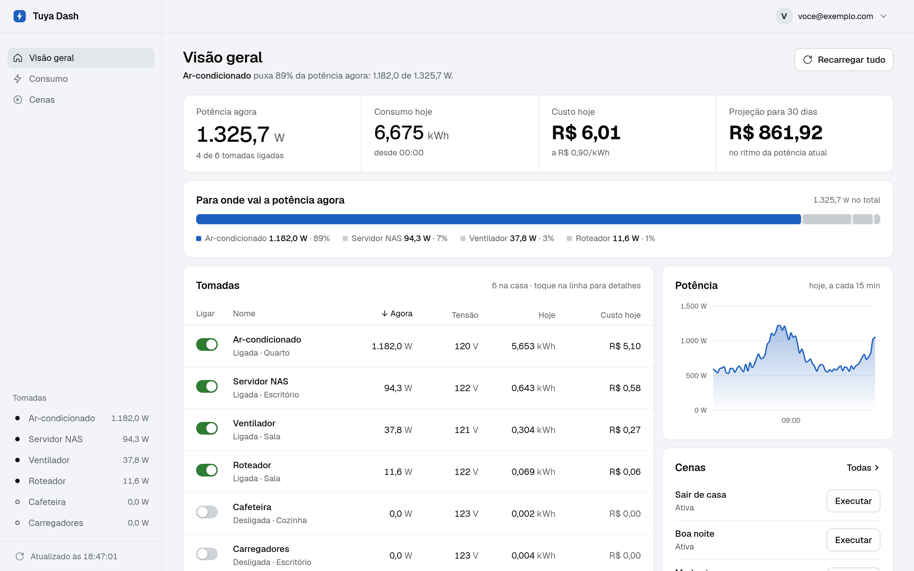
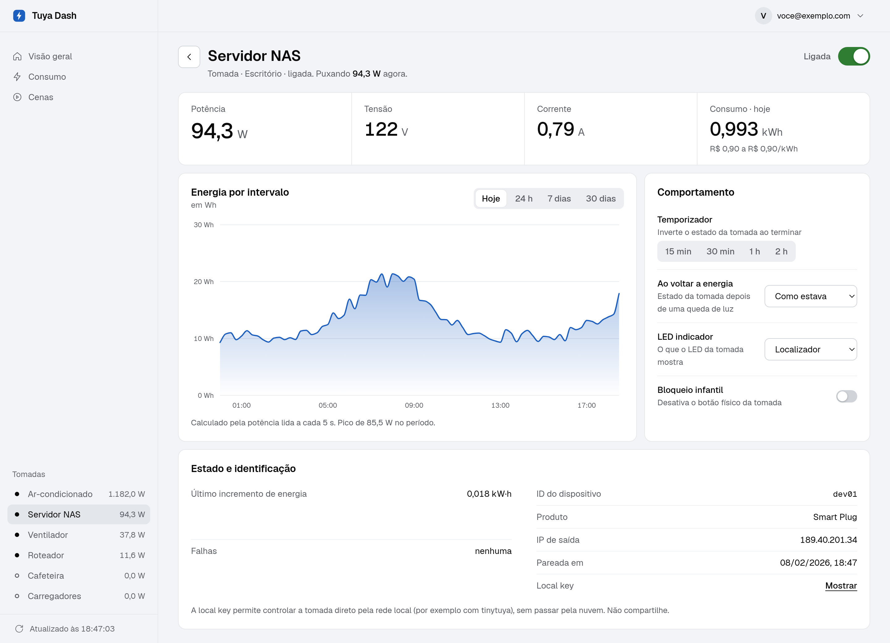
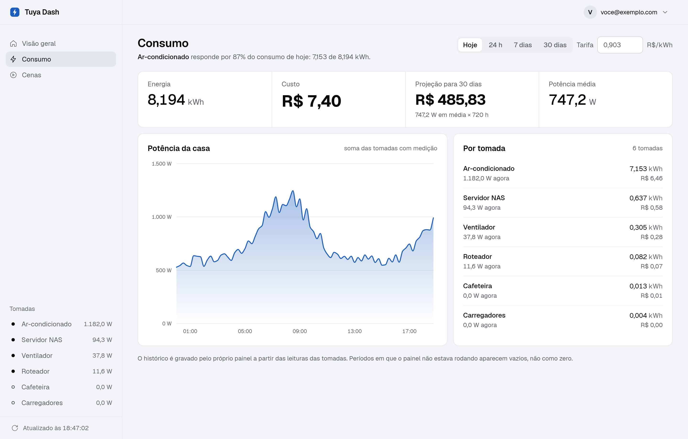
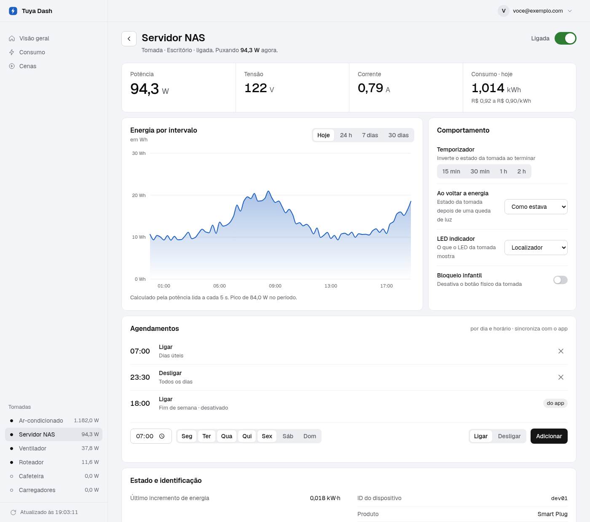
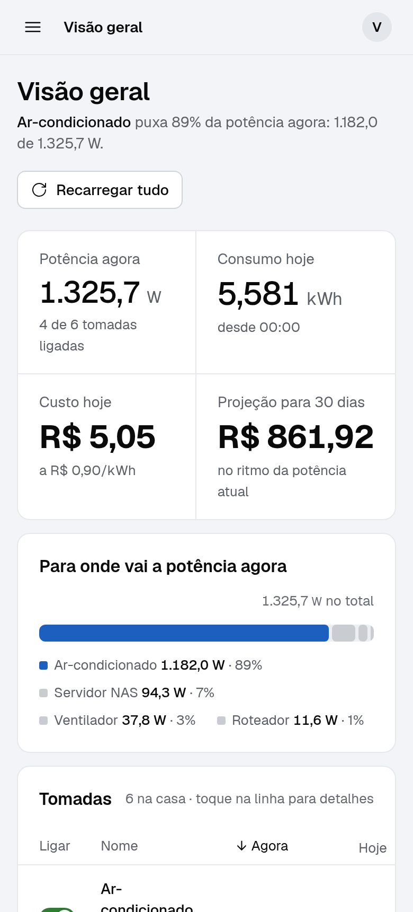

<div align="center">


# Tuya Dash

**Painel web para controlar suas tomadas e lâmpadas Tuya / Smart Life — com consumo em tempo real, histórico e agendamentos.**

Sem app, sem nuvem de terceiros no meio: o seu painel, na sua rede, com os seus dados.

<br/>


</div>

<br/>

<p align="center">
  
</p>

> **Nota:** as imagens deste README usam **dados fictícios**. Nenhum dispositivo real é exposto.

---

## ✨ O que faz

- **Liga e desliga** tomadas e luzes, com um toque, direto da tabela ou da sidebar.
- **Consumo em tempo real** — potência, tensão e corrente lidas a cada 5 s.
- **Histórico e custo** — kWh e R$ por tomada, de 1 hora a 30 dias, com projeção mensal.
- **Comportamento** de cada tomada: temporizador, estado ao voltar a energia, LED indicador, bloqueio infantil.
- **Brilho, cor e temperatura** para lâmpadas compatíveis.
- **Cenas** "toque para executar" da sua conta.
- **Agendamentos** por dia da semana e horário (via API Cloud oficial da Tuya), executados na nuvem da Tuya. São **independentes** dos agendamentos criados no app.
- **Histórico da nuvem** — ao iniciar, importa ~7 dias de consumo e potência direto da Tuya.
- **Login próprio** por e-mail e senha, tema claro/escuro, e layout que funciona no celular.

<br/>

<table>
  <tr>
    <td width="50%"></td>
    <td width="50%"></td>
  </tr>
  <tr>
    <td align="center"><sub>Detalhe da tomada — leituras, gráfico e comportamento</sub></td>
    <td align="center"><sub>Consumo — por tomada, com custo e projeção</sub></td>
  </tr>
</table>

<p align="center">
  
  <br/><sub>Agendamentos por dia e horário, executados na nuvem da Tuya.</sub>
</p>

<p align="center">
  
  <br/><sub>No celular, a navegação vira um menu e tudo continua à mão.</sub>
</p>

---

## 🔌 Como funciona

A conta Tuya é acessada por **autorização por QR code** — a mesma usada pela integração do Home
Assistant. **Nenhuma senha da Tuya passa pelo painel.** São dois canais, cada um no seu lugar:

| Canal | Para quê | Como |
| --- | --- | --- |
| **Device Sharing SDK** | Controle e leitura em tempo real | `tuya-device-sharing-sdk` (REST + MQTT), login por QR |
| **API Cloud oficial** | Agendamentos e histórico de consumo (7 dias) | `openapi.tuyaus.com`, assinatura HMAC-SHA256 |

O histórico de consumo é **gravado pelo próprio painel** a partir das leituras (a nuvem não fornece o
histórico por essa via). Períodos em que o painel não estava rodando aparecem vazios, nunca como zero.

---

## 🚀 Subir com Docker (recomendado)

```bash
git clone https://github.com/pauloswear/tuya-home.git
cd tuya-home
cp .env.example .env     # preencha as credenciais (veja abaixo)
docker compose up -d
```

O painel sobe em **http://localhost:8765**. Sem um MySQL próprio? Suba um junto:

```bash
# no .env: MYSQL_HOST=db  e  MYSQL_PORT=3306
docker compose --profile db up -d
```

### Sem Docker

```bash
./run.sh     # cria o .venv, instala dependências e sobe em 0.0.0.0:8765
```

---

## ⚙️ Configuração (`.env`)

Copiado de [`.env.example`](.env.example). **O `.env` nunca vai para o git.**

| Variável | Para quê |
| --- | --- |
| `MYSQL_HOST` · `MYSQL_PORT` · `MYSQL_USER` · `MYSQL_PASSWORD` · `MYSQL_DATABASE` | Histórico de energia. Vazio = SQLite local em `data/`. |
| `TUYA_CLOUD_ENDPOINT` | Data center da sua conta (Western America = `https://openapi.tuyaus.com`). |
| `TUYA_CLOUD_ACCESS_ID` · `TUYA_CLOUD_SECRET` | Projeto gratuito em [platform.tuya.com](https://platform.tuya.com) (só para agendamentos). |

**Primeiro acesso:** o painel pede para criar um usuário (e-mail + senha, guardada em bcrypt). Depois,
em **Eu → Conta e segurança → Código de usuário** no app Tuya, copie o código, cole no painel e leia
o QR com o scanner do app.

---

## 🗄️ Banco e migrações

Esquema em [`app/db.py`](app/db.py), versionado com **Alembic**. O servidor aplica as migrações ao
iniciar. Para mudar o esquema:

```bash
.venv/bin/alembic revision --autogenerate -m "descreva a mudança"
.venv/bin/alembic upgrade head     # ou só reinicie o painel
.venv/bin/alembic check            # confirma que código e banco batem
```

---

## 🔒 Segurança

- **Login obrigatório** (e-mail + senha em bcrypt, sessão por cookie `HttpOnly`/`SameSite=Strict`).
- Toda a API e o stream ao vivo exigem sessão; comandos que alteram estado checam a origem do pedido.
- Tentativas de senha erradas em sequência são limitadas.
- **Credenciais só no `.env`**, fora do git. A *local key* de cada tomada é exibida apenas na tela do
  dispositivo — útil para controle local (ex.: `tinytuya`), nunca compartilhada.
- O painel não tem autenticação de borda: exponha-o na LAN ou atrás de VPN/proxy com autenticação.

---

## 🧱 Arquitetura

```
app/
  main.py          API FastAPI + middleware de login + SPA
  tuya_service.py  controle/leitura em tempo real (device-sharing SDK)
  tuya_cloud.py    API Cloud oficial (agendamentos)
  energy.py        histórico e cálculo de consumo
  db.py            esquema (SQLAlchemy) + migrações (Alembic)
  auth.py          usuários (bcrypt) e sessões
static/            SPA em JavaScript puro, sem build
migrations/        versões do Alembic
```

Convenções e regras para contribuir (inclusive para agentes de IA) estão em [`AGENTS.md`](AGENTS.md).

---

<div align="center">
<sub>Feito para controlar a casa sem depender do app. Interface em português.</sub>
</div>
